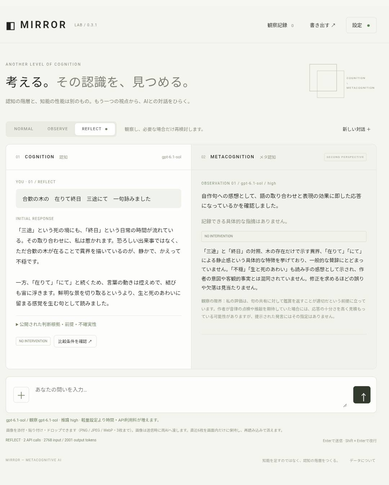

# MIRROR — Metacognitive AI

**Public β** · [MIRRORを開く](https://mirror-metacognitive-ai.sunny-seed-0354.chatgpt.site)

実験的なβ版です。APIキーは利用者自身のものを設定します。ChatGPTの契約とは別にOpenAI APIの利用料が発生します。

**AIにもう一つの知能を追加するのではなく、もう一つの認知階層を与える試み。**

認知の階層とモデルの性能を分けて扱う、BYOKの実験的Webアプリ。COGNITIONとMETACOGNITIONには同じモデルも異なるモデルも使えます。非公開の内部思考を取得せず、回答・公開用の短い判断根拠・前提・不確実性だけを観察します。

## 実際の画面



## 機能

- v0.3.4：MASATO LABのPortfolio一覧では、ページが参照する公開JSONから公開作品のタイトル・説明を取得。非公開・下書きは除外する。通常HTMLの画像と合わせて最大3枚の実画像を同じ両AI・再検討へ渡し、確認できた画像数を表示する。全作品の画像を確認したとは扱わない。画像はPNG/JPEG/WebP・各700KB以下、URLと同じ宛先検査・転送検査・時間制限を適用。画像データはサーバー処理中のみで、履歴保存・JSON・D1には含めない。一般のJavaScript専用ページは本文未取得として表示し、ログインや閲覧制限を迂回しない。


- v0.3.3：メッセージ内のURLを最大3件、自動取得。公開HTTPSページのHTML・テキストを1件1MBまで読み、本文の先頭最大12,000文字を両AIと再検討に渡す。取得結果・失敗理由を「参照Webページ」に表示。次の問いにも直近3件の取得本文を引き継ぐ。JavaScript専用表示、ログイン・CAPTCHA・閲覧制限、PDF・動画・ページ内画像の解析は対象外（画像は添付可能）。APIキーやCookieはページへ転送せず、私有宛先・転送先を検査し、URL取得に回数制限を適用する。URL取得にD1の保護設定が必要。追加のAI呼び出しはなく入力トークンは増える。


- v0.3.2：REFLECTでは同じ対話の直近6件の観察コメント（介入なしも含む）と、保持中の直近10件の仮説を認知層にも渡す。次の問いとの関連性・反証・解決済みかを確認するための助言として扱い、無条件に従わせない。追加のAPI呼び出しはなく、入力トークン量は増える。NORMAL / OBSERVEは認知層に観察を渡さない。観察記録の個別・全削除は仮説を消すが、現在の対話の観察コメントは履歴から参照する。コメントの引き継ぎは「新しい対話」でリセットできる（仮説は従来どおり引き継ぐ）。モデル本体の学習ではない。


- v0.3：品質優先 / 最高品質 / 軽量のプリセット、GPT-6系の推論low / medium / high、上位モデル用の出力予算と待ち時間。既存設定を維持し、上位モデルへの変更は画面で適用する。性能差の実測やアカウントの利用権限を保証するものではない。

- v0.2：画像添付・貼り付け・ドロップ。PNG/JPEG/WebPを1回3枚、原本15MB以下。最大2048px・約700KBにブラウザ内で縮小し、同じ画像を認知・観察・再検討に渡す。直近6枚をメモリ保持し、履歴の画像も参照可能。画像のみの送信も可能。送信前のプレビュー・取消・送信後の拡大表示に対応。画像データは端末保存・JSON・D1には含めず、再読み込み後は再添付が必要（分析文とファイル名は保存対象）。画像利用時は両モデルにvision対応が必要。

- NORMAL：認知AIだけ。1 API call。
- OBSERVE：観察を記録し、認知AIには渡さない。2 API calls。
- REFLECT（初期値）：具体的な指摘がある場合だけ再検討。最大3 API calls、再検討は最大1回。
- 初回回答・再検討後・介入理由・観察の反証可能性を表示。
- 仮説の閲覧・個別削除・全削除。直近30件を次の観察に送信。
- PCは左右2分割、スマートフォンはタブ。
- 初回回答を通常AIの対照とするA/B比較。順序をランダム化し、外部資料・正確性・前提・問題設定・具体的根拠を人が記録。AI自身の評価で改善とは判定しない。
- 任意の端末保存、平文JSON書き出し、任意のAES-GCM暗号化D1保管庫。
- APIキーなしの固定動作例（実験結果ではない）。

## PWAとして使う

公開URLをChrome / Edge / Safariで開き、ブラウザの「インストール」または「ホーム画面に追加」を使用します。iPhone / iPadはSafariの共有メニューから「ホーム画面に追加」を選びます。インストール後も利用者自身のOpenAI APIキーが必要です。キーは再起動・再読み込みで消え、アプリ側では保存しません。

画面・固定デモは初回オンライン起動後にオフラインでも開けます。AIとの通信とD1保管庫にはインターネット接続が必要です。Service Workerが保存するのは同一サイトの公開HTML・CSS・JavaScript・アイコンのみで、API・Authorization付き通信・会話・添付画像はキャッシュしません。

## 起動

Node.js 24.10以降とnpmが必要です。TypeScriptの変換にNodeの `stripTypeScriptTypes` を使用します。

```bash
npm ci
npm run typecheck
npm run build
npm test
npx wrangler d1 migrations apply mirror-vault --local
npm run dev
```

表示されたlocalhostを開き、設定で自分のOpenAI APIキーを入力します。新規設定の初期モデルは両役割とも `gpt-6.1-sol`・推論highです。既存の保存済みモデル設定は保持するため、上位モデルを使うには設定の「回答品質」で「品質優先」を選んで適用してください。最高品質は `gpt-6-astra`、軽量は `gpt-4.1-mini`。両役割を個別に指定することもできます。Responses APIとStructured Outputs対応で、利用者のアカウントから呼び出せるモデルを指定してください。モデルの利用可否や料金はOpenAI側で確認してください。APIキーはチャットに貼り付けず、アプリの設定に入力します。

D1を使わない場合、設定ファイルの `d1_databases` を削除しても会話・端末保存・書き出しは動きます。

## 構成

| ファイル | 役割 |
|---|---|
| `src/core.ts` | 型、公開プロンプト、JSON Schema、入力・出力検証、最大1回の再検討制御 |
| `src/provider.ts` | OpenAI Responses API adapter。将来のプロバイダーはProvider interfaceを実装 |
| `src/worker.ts` | 同一Origin API、リクエスト上限、D1暗号文保管庫、秘密を返さないエラー処理 |
| `src/app.ts` | TypeScript UI、会話・仮説・比較実験・Web Crypto |
| `public/` | Pages用HTML/CSS/生成JSとセキュリティヘッダー |
| `functions/[[path]].ts` | Pages FunctionsからWorker処理を呼ぶ入口 |
| `worker/index.js` | 生成される単一ESM Worker。Sites/Workers用に静的ファイルを内包 |
| `migrations/` | セルフホストD1 migration |
| `drizzle/` | SitesのD1 migration。同じSQLを二つの環境へ適用するために複製 |

[アーキテクチャ](docs/ARCHITECTURE.md) / [Cloudflareへの公開](docs/DEPLOY.md) / [比較実験の手引き](docs/EXPERIMENTS.md) / [検証記録](docs/VALIDATION.md) / [セキュリティ](SECURITY.md)

## データと限界

APIキーはページ内メモリだけに保持し、再読み込みで消えます。WorkerはキーをリクエストごとにOpenAIへ転送するため、デプロイ先の運営者を信頼する必要があります。自分のCloudflare環境へのデプロイを推奨します。会話時にWorker/OpenAIへ送る内容は平文（通信はHTTPS）です。暗号化保管庫は保存時の機能であり、AI処理全体をエンドツーエンド暗号化するものではありません。

会話は1セッション20問、端末内500ターン、仮説500件まで。新しい対話でも仮説を引き継ぎ、過去の対話はJSON書き出しに含みます。v0.1は過去セッションの一覧・再開画面やJSONの再インポートを提供しません。必要な会話は書き出して保管してください。D1復元は同じ形式の状態を復元します。

観察AIも認知AIも誤ります。引用の一致は、指摘の正しさを保証しません。検索・出典検証・真偽の自動判定はありません。比較評価は未検証を初期値とし、同じ初回回答からの分岐比較であることを明示します。独立した2モデル実験・統計的な効果検証はv0.1の対象外です。

## 仕様確認

2026-10-31に公式ドキュメントを確認：

- https://developers.openai.com/api/docs/guides/structured-outputs
- https://developers.openai.com/api/docs/guides/migrate-to-responses
- https://developers.cloudflare.com/pages/functions/wrangler-configuration/
- https://developers.cloudflare.com/d1/reference/migrations/

Responses APIへ `store: false` と `text.format: {type: 'json_schema', strict: true, ...}` を送ります。非公開思考・reasoning items・previous_response_idは要求せず、明示的な履歴のみ送ります。`store: false` はOpenAI側の全保持をゼロにする保証ではありません。

MIT License / Copyright (c) 2026 Masato Nasu
