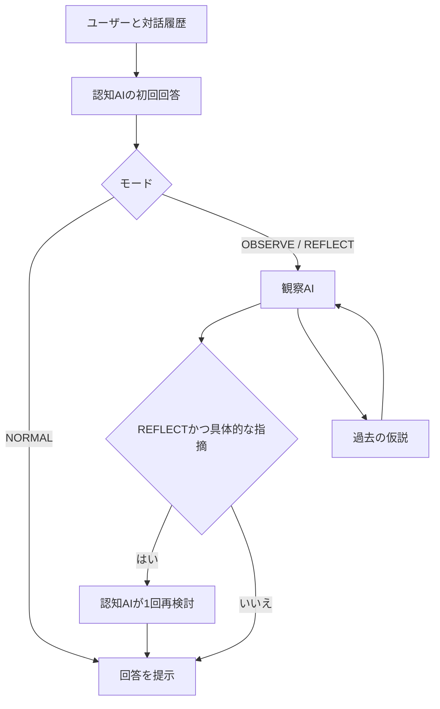

# Architecture / v0.1

## 認知の階層

メタ認知AIは認知AIより賢いことを前提としない。異なる役割と入力の配置によって、回答を対象化する。観察は権威ではなく検証可能な仮説。認知AIは根拠のない介入を拒否できる。

## 1ターンの制御

1. 入力のmode、モデルID、文字数、履歴ロール、履歴数、仮説数をWorkerで検証。
2. 認知AIに質問と初回回答と同じ履歴を与える。観察AIの仮説は初回認知には渡さない。
3. JSON Schemaで `answer / grounds / assumptions / uncertainty` を生成し、受信後も型を検証。
4. NORMALなら終了。その他は質問、履歴、初回の公開情報、直近30件の仮説を観察AIへ。
5. 観察結果は問題設定、引用、反証、検証方法、確信度、介入の要否、依頼、自己の限界を含む。回答中に実在しない引用は除外し、有効な指摘がなければ介入を無効化。
6. REFLECTかつ有効な指摘・介入理由・具体的な依頼が揃う場合だけ、認知AIへ初回回答と観察を渡す。1回で終了し、再観察ループは作らない。
7. 観察・再検討が失敗した場合は初回回答を保持し、完了したように見せず警告を表示。

公開用の短い根拠を求めるが、隠された推論過程を求めない。履歴・引用・観察は非信頼データとして扱うよう固定instructionsで指定する。ただしLLMのプロンプト注入耐性を完全には保証しない。

## データ経路

| データ | ブラウザ | Worker | OpenAI | D1 |
|---|---|---|---|---|
| APIキー | メモリのみ | 呼び出し中のみ | Authorization | 保存しない |
| 質問・回答 | メモリ、任意で端末保存 | 処理中のみ | 必要な履歴を送信 | 任意の暗号文のみ |
| 仮説 | 同上 | 観察入力のみ | 直近30件 | 任意の暗号文のみ |
| 比較評価 | 同上 | 保管庫の暗号文のみ | 送信しない | 任意の暗号文のみ |
| 復元コードのAES鍵 | メモリ、手動控え | 送信しない | 送信しない | 保存しない |
| 保管庫access token | コードから導出 | SHA-256で識別子化 | 送信しない | ハッシュのみ |

ブラウザの暗号化はAES-256-GCM、保存ごとに96bitランダムIV。復元コードは256bit乱数。AES鍵とドメイン分離したハッシュから保管庫access tokenを導出し、サーバーはさらにhashした値を主キーにする。認可は256bit bearer capabilityの所持で行う。復元コードは復号権限と削除権限を含む秘密として管理する。

D1にはid、ciphertext、updated_atのみ。サーバー側で平文会話を保存せず、暗号化済みの状態を1件upsertする。復元は現在の状態を置き換えるため、画面で確認する。端末保存の削除、仮説の削除、D1の削除は別操作。

## プロバイダー

`Provider.generate(model, instructions, payload, schema)` と `usage` に依存する。OpenAI adapterだけがAPI URL、Authorization、Responses形式、refusalとincomplete処理を持つ。Anthropic/Gemini/local adapterでは同じ構造の出力を返し、必ずcoreで再検証する。v0.1では他社/ローカル接続用の任意URL入力は設けない（SSRFやキーの誤転送を避ける）。

## 配置

Cloudflare Pages + Pages Functions（Workers runtime）を通常のセルフホスト先とする。同じコードは単一Workersのfetch exportにもなる。Sitesでは静的アセットを内包する単一ESMを公開し、D1 bindingを自動設定する。MASATO LABのファイル、Cloudflare project、DNSは一切参照しない。

## v0.2 画像入力

ブラウザでデコードし、白背景のJPEGへ再描画することでメタデータを含む原本を送らず、最長2048px・1枚700KB以下に正規化する。最大3枚/投稿、APIリクエストに含める現在画像と履歴画像は合計6枚まで。画像がない本文リクエストは従来180KB、画像付きは6.5MBが上限。Workerでdata URL、MIME、base64、ファイルヘッダー、サイズと枚数を再検証し、外部画像URLやSVGは受け付けない。

Provider.generateの第5引数にImageAttachment配列を渡す。JSON本文に画像base64を混ぜず、Responses APIのinput_imageパートとして渡す。テキストには1始まりのimageIndicesを示し、過去の質問と今回の画像を対応づける。同じ画像を初回回答、観察、再検討に供給する。画像が省略/消失した履歴にはその旨を明示し、見ていない画像を見たと扱わせない。

画像データはブラウザメモリで直近6枚のみ保持。永続化用stateからimagesを除外し、ファイル名だけ残す。Workerの回答にも画像データをエコーしない。OpenAIは送信された画像を処理するため、その保持方針が適用される。画像内の文字も非信頼データとして役割指示に明記。

## REFLECT feedback / v0.3.2

The frontend projects up to six prior non-demo observations in the current conversation to bounded question/framing/reason/fallibility/revised records. No new persistence store or database table is introduced. REFLECT cognition receives these records plus up to ten bounded hypotheses; its reconsideration receives the same context. NORMAL and OBSERVE cognition receive neither. Deleting hypotheses removes them on the next request; existing observation comments remain part of the current conversation until a new conversation starts. Zero-finding observations can still inform cognition through their reason/framing, without automatically causing another API call. The provider does not train or fine-tune a model.
